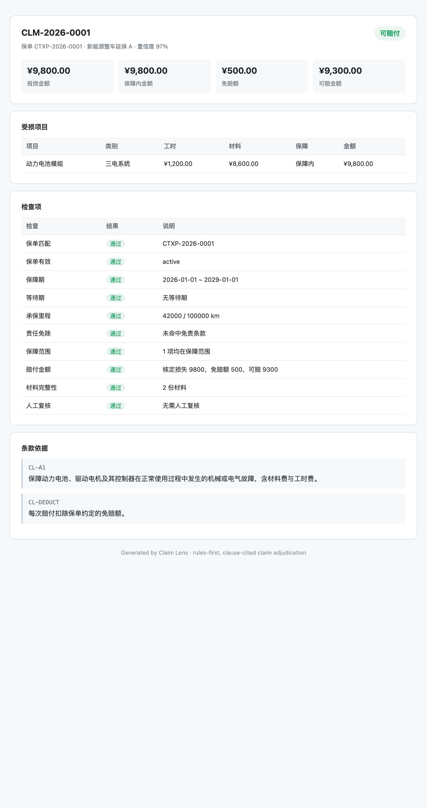

# Claim Lens

**Rules-first, clause-cited claim adjudication for warranty and insurance — AI optional.**

Most "AI claims" demos are a chat box that guesses. Claim Lens is the opposite: deterministic checks run first, every decision points to the exact policy clause, and the same JSON is returned in CLI, library, and report form. An LLM can explain the result, but it cannot silently change it.



```bash
node bin/cli.js assess --policy data/policies/p1.json --claim data/claims/c1.json
```

```text
Claim Lens · CLM-2026-0001
保单 CTXP-2026-0001 · 新能源整车延保 A

结论：可赔付
报损 ¥9,800.00 · 保障内 ¥9,800.00 · 免赔 ¥500.00 · 可赔 ¥9,300.00
置信度 97%

检查项
  ✓ 保单匹配：CTXP-2026-0001
  ✓ 保障期：2026-01-01 ~ 2029-01-01
  ✓ 承保里程：42000 / 100000 km
  ✓ 责任免除：未命中免责条款
  ✓ 保障范围：1 项均在保障范围

条款依据
  CL-A1：保障动力电池、驱动电机及其控制器在正常使用过程中发生的机械或电气故障，含材料费与工时费。
  CL-DEDUCT：每次赔付扣除保单约定的免赔额。
```

## Why

Insurance agents and warranty platforms are adding LLM claim assistants, but a plausible answer is not an auditable decision. Claim Lens separates the two:

- **Rules decide** — coverage, exclusions, waiting period, mileage, deductible, per-claim limit, annual limit, documentation.
- **Clauses justify** — each pass/fail is linked to a clause ID and quote.
- **Humans review the edge cases** — high amounts, missing invoices, frequent claims, short descriptions go to `manual_review` instead of being auto-approved.
- **LLM is optional** — `--explain` writes a short narrative via any OpenAI-compatible endpoint; without a key it uses a deterministic template.

## Quick start

Requires Node.js 20+. The core rules engine has no dependencies; install once for PDF import and the MCP server.

```bash
git clone https://github.com/cdcailf/claim-lens.git
cd claim-lens
npm install

node bin/cli.js list
node bin/cli.js assess \
  --policy data/policies/p1.json \
  --claim data/claims/c1.json \
  --html examples/report.html

node bin/cli.js eval
node --test tests/*.test.js
```

No build step, no database.

## Eval

The repository ships 20 synthetic cases covering the decisions that break naive claim bots:

```text
Claim Lens eval · 20/20 passed · accuracy 100%
```

Cases include: expired policy, mileage over limit, operating-vehicle exclusion, uncovered wear parts, partial payment, deductible larger than loss, per-claim cap, annual remaining cap, waiting period, policy mismatch, inactive policy, missing documents, high amount, frequent claims, short description, pre-coverage incident, unknown category.

The eval is intentionally small and readable: `src/cases.js`. Add a case when you add a rule.

## How it works

```
policy.json ─┐
             ├─► checks ─► amount calculation ─► decision
claim.json ──┘                │
                              ├─ citations (clauseId + quote)
                              └─ manualReviewReasons
```

Checks are ordered from hard stops to soft signals:

1. policy number match
2. policy active
3. incident inside coverage period
4. waiting period
5. mileage limit
6. exclusion keywords
7. coverage categories
8. deductible, per-claim limit, annual remaining limit
9. document completeness
10. manual-review triggers

Decision values: `approved`, `partial`, `rejected`, `manual_review`.

## PDF import

Digital PDFs can be turned into a draft policy JSON. Scanned PDFs need OCR and are not supported.

```bash
node bin/cli.js import \
  --pdf examples/policy-sample.pdf \
  --out data/policies/imported.json
```

The importer extracts policy number, period, mileage, deductible, per-claim/annual limits, coverage categories, exclusions, and `第X条` clause text. It always writes a draft plus warnings — review the coverage and exclusion lists before using it for real decisions.

`examples/policy-sample.pdf` is a synthetic one-page policy used by the tests.

## MCP server

Claim Lens is agent-native: expose `list_policies`, `get_policy`, `assess_claim`, and `explain_claim` over MCP stdio.

Claude Code:

```bash
claude mcp add claim-lens -- node /absolute/path/to/claim-lens/bin/cli.js mcp
```

Claude Desktop / Cursor:

```json
{
  "mcpServers": {
    "claim-lens": {
      "command": "node",
      "args": ["/absolute/path/to/claim-lens/bin/cli.js", "mcp"]
    }
  }
}
```

Then an agent can do:

```text
Assess CLM-2026-0001 against CTXP-2026-0001 and explain the decision.
```

The MCP tools return the same JSON as the CLI. The agent gets the decision, amounts, checks, and clause citations — not a free-form guess.

## Use as a library

```js
import { assessClaim } from 'claim-lens';

const result = assessClaim(policy, claim);
console.log(result.decision, result.approvedAmount, result.citations);
```

## Optional LLM explanation

```bash
export LLM_API_KEY=sk-...
export LLM_BASE_URL=https://api.openai.com/v1   # any OpenAI-compatible endpoint
export LLM_MODEL=gpt-4o-mini

node bin/cli.js assess --policy ... --claim ... --explain
```

The LLM only writes prose. Amounts, decisions, and citations come from the rules engine.

## Data model

A policy defines coverage categories, exclusions, limits, and a clause dictionary:

```json
{
  "policyNo": "CTXP-2026-0001",
  "period": { "start": "2026-01-01", "end": "2029-01-01" },
  "mileageLimit": 100000,
  "deductible": 500,
  "perClaimLimit": 50000,
  "annualLimit": 100000,
  "coverage": [{ "code": "A1", "name": "三电系统", "covered": true, "clauseId": "CL-A1" }],
  "exclusions": [{ "code": "EX-01", "keywords": ["营运", "网约车"], "clauseId": "CL-EX-01" }],
  "clauses": { "CL-A1": "…" }
}
```

A claim supplies the incident, mileage, damage items, attachments, and prior claim count:

```json
{
  "claimNo": "CLM-2026-0001",
  "policyNo": "CTXP-2026-0001",
  "incidentAt": "2026-06-01",
  "mileage": 42000,
  "description": "动力电池报警，检查确认电池模组故障。",
  "attachments": ["invoice.jpg"],
  "damageItems": [{ "part": "动力电池模组", "category": "三电系统", "labor": 1200, "parts": 8600 }]
}
```

All sample data is synthetic. Do not put real customer data in this repository.

## HTML report

`--html examples/report.html` produces a printable, single-file report with the decision, amount breakdown, checks, reasons, and clause quotes.

## Roadmap

- OCR for scanned policy PDFs
- Configurable rule packs per product line
- Historical claim deduplication and fraud signals
- More languages in the rule pack

## Disclaimer

Claim Lens is a decision-support sandbox, not an insurance policy, legal opinion, or claim adjudication service. Rules and sample policies are simplified and synthetic. Validate against your own policy wording and regulatory requirements before production use.

## License

MIT. See [LICENSE](LICENSE).
