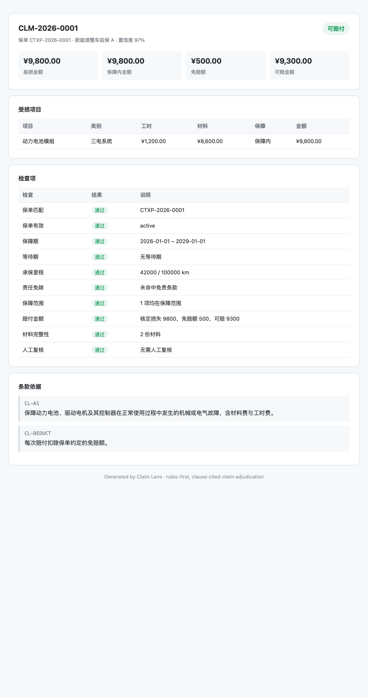

# Claim Lens

**规则优先、条款可追溯的延保/保险理赔判定工具，AI 可选。**

大多数「AI 理赔」演示是一个会猜的聊天框。Claim Lens 反过来：先跑确定性规则，每个结论都指向具体条款，CLI、库、报告返回同一份 JSON。LLM 可以写解释，但不能偷偷改结论。



```bash
node bin/cli.js assess --policy data/policies/p1.json --claim data/claims/c1.json
```

```text
结论：可赔付
报损 ¥9,800.00 · 保障内 ¥9,800.00 · 免赔 ¥500.00 · 可赔 ¥9,300.00

检查项
  ✓ 保单匹配：CTXP-2026-0001
  ✓ 保障期：2026-01-01 ~ 2029-01-01
  ✓ 承保里程：42000 / 100000 km
  ✓ 责任免除：未命中免责条款
  ✓ 保障范围：1 项均在保障范围

条款依据
  CL-A1：保障动力电池、驱动电机及其控制器…
  CL-DEDUCT：每次赔付扣除保单约定的免赔额。
```

## 为什么做

保险和延保都在接 LLM 理赔助手，但「说得像」不等于「判得对」。Claim Lens 把两件事分开：

- **规则判定**：保障期、等待期、里程、免责、保障类别、免赔额、单次限额、年度限额、材料完整性
- **条款引用**：每个检查项都能追到条款 ID 和原文
- **边缘案例转人工**：大额、缺发票、频繁理赔、描述过短，不自动通过
- **LLM 只做解释**：`--explain` 可用任意 OpenAI 兼容接口；没有 key 就用本地模板

## 快速开始

需要 Node.js 20+。核心规则引擎零依赖；PDF 导入和 MCP 需要先安装依赖。

```bash
git clone https://github.com/cdcailf/claim-lens.git
cd claim-lens
npm install

node bin/cli.js list
node bin/cli.js assess \
  --policy data/policies/p1.json \
  --claim data/claims/c1.json \
  --html examples/report.html

node bin/cli.js eval
node --test tests/*.test.js
```

不需要构建、不需要数据库。

## 评测

仓库自带 20 个合成案例，覆盖容易出错的场景：

```text
Claim Lens eval · 20/20 passed · accuracy 100%
```

包括：保单过期、里程超限、营运车免责、易损件不保、部分赔付、免赔额大于损失、单次限额、年度剩余额度、等待期、保单号不匹配、保单失效、缺材料、大额转人工、频繁理赔、描述过短、事故早于起保、未知类别。

案例在 `src/cases.js`，加规则就加案例。

## 判定流程

```
policy.json ─┐
             ├─► 检查项 ─► 金额计算 ─► 结论
claim.json ──┘                │
                              ├─ 条款引用（clauseId + 原文）
                              └─ 人工复核原因
```

结论值：`approved`、`partial`、`rejected`、`manual_review`。

## PDF 导入

支持数字版 PDF，扫描件需要 OCR，暂不支持。

```bash
node bin/cli.js import \
  --pdf examples/policy-sample.pdf \
  --out data/policies/imported.json
```

会提取保单号、保障期间、里程、免赔额、单次/年度限额、保障类别、免责关键词和 `第X条` 条款原文，并输出待复核提示。生成的是草稿，正式使用前请核对保障与免责清单。

## MCP Server

把 `list_policies`、`get_policy`、`assess_claim`、`explain_claim` 暴露给 Claude Code / Codex / Cursor。

```bash
claude mcp add claim-lens -- node /绝对路径/claim-lens/bin/cli.js mcp
```

Claude Desktop / Cursor 配置：

```json
{
  "mcpServers": {
    "claim-lens": {
      "command": "node",
      "args": ["/绝对路径/claim-lens/bin/cli.js", "mcp"]
    }
  }
}
```

Agent 可以直接问「用 CTXP-2026-0001 评估这个理赔并解释」，拿到的是带条款引用的结构化结论，不是自由发挥。

## 作为库使用

```js
import { assessClaim } from 'claim-lens';

const result = assessClaim(policy, claim);
console.log(result.decision, result.approvedAmount, result.citations);
```

## 可选 LLM 解释

```bash
export LLM_API_KEY=sk-...
export LLM_BASE_URL=https://api.openai.com/v1
export LLM_MODEL=gpt-4o-mini

node bin/cli.js assess --policy ... --claim ... --explain
```

金额、结论、条款来自规则引擎，LLM 只负责写说明。

## 数据

所有保单、车辆、理赔数据均为合成示例，不要放真实客户数据。

## 免责声明

Claim Lens 是决策辅助沙盒，不是保险条款、法律意见或理赔服务。规则和示例保单经过简化，上线前请按自己的条款和监管要求校验。

## 许可证

MIT。
